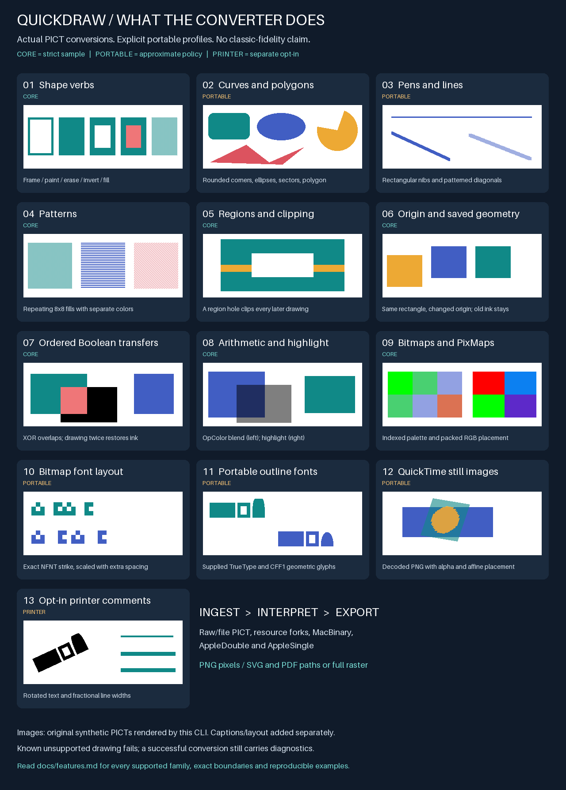

# Illustrated QuickDraw feature guide

This is the user-facing catalog of **all supported feature families**, not a
claim of complete QuickDraw emulation. The [exact opcode/operand matrix](support.md)
is authoritative for individual combinations; the [CLI contract](cli.md) defines
arguments, font bindings, limits and error handling.



[Open the browser-renderable SVG](images/quickdraw-features.svg) or
[full-size PNG](images/quickdraw-features.png). Numbers below match the image.
The artwork is generated by the converter from original synthetic PICTs.
Labels are added separately. It is **not** output captured from a classic Mac.

**Core** means the illustrated case passes strict mode. **Portable** requires
`--fidelity approximate`; its deterministic rules are not historical equivalence.
**Printer** additionally requires `--printer-comments apple-portable`.
Strict mode rejects known approximations; it is not a pixel-identity guarantee.

## 01. Shape verbs

Frame draws the inside border; paint uses the pen pattern; erase uses the
background pattern; invert changes existing destination pixels; fill uses the
fill pattern. Rectangles, rounded rectangles, ovals, arcs, polygons and regions
support their five documented verbs. Same-rectangle, same-rounded-rectangle,
same-oval and same-arc records reuse bounds while reading current state.
The illustration shows the five rectangle verbs from left to right.

## 02. Curves, polygons and regions

Rounded rectangles use the recorded oval size, clamped to the rectangle.
Ovals use elliptical coverage. Arcs have signed clockwise sweeps from 12 o'clock;
filled arcs are sectors, while framed arcs exclude the two radii. Polygons use
even-odd filling and closed outlines. These curves/polygons are portable
approximations, not recovered classic edge rules.

Rectangular and transition-encoded regions support holes and disconnected spans.
Rectangular frames are strict; complex region frames use portable erosion.
Same-polygon/same-region slots remain unsupported: Apple's appendix itself marks
them unimplemented. Arbitrary reserved slots do not acquire drawing semantics.

## 03. Pens, lines and coordinates

Recorded rectangular pen width/height, pen pattern and pen mode affect drawing.
Line, LineFrom, ShortLine and ShortLineFrom preserve ordered pen movement.
Axis-aligned lines are strict; diagonals use portable integer coverage.
Thick stamps are unioned before applying a transfer, so one stroke does not
cancel itself under XOR. Zero pen dimensions suppress framing/lines.

Rectangles are half-open; negative-size geometric rectangles draw nothing.
Colors include classic color constants and RGB16 records, reduced to high
8-bit components in the declared RGB8 framebuffer.

## 04. Bit patterns and pixel patterns

Independent background, pen and fill patterns repeat an 8x8 one-bit tile.
Foreground/background colors map pattern bits. Copy, complemented copy and
transparent pattern placement can remain native SVG/PDF tiling resources.
Pattern phase follows signed picture coordinates, including origin changes.

Pixel patterns also support bit fallback, solid RGB and bounded indexed color
tiles of power-of-two dimensions. Color tiles copy their own RGB, rather than
being silently recolored by the pen mode. The image illustrates three ordinary
one-bit fill patterns; it does not imply that all pixel-pattern formats work.

## 05. Clipping and masks

Clip records replace the current rectangular or transition-encoded clip.
All later drawing intersects that clip and the current picture viewport.
The example paints through a region with a central hole.
CopyBits region variants additionally supply a destination mask; QuickTime
images have separate source masks. Masks, source cropping, placement and origin
are interpreted together, not flattened into a guessed bounding rectangle.

## 06. Origin and ordered state

Origin applies cumulative horizontal/vertical deltas without moving pixels
already painted. Logical pen position, saved shape bounds and clip state remain
ordered interpreter state. The example redraws the same saved rectangle after
origin changes; the old colors remain where they were painted.
Text delta records use the previous text start, not the advanced graphics pen.

## 07. Boolean transfer modes

Source modes 0-7 implement copy, OR, XOR, BIC and their source-inverted forms.
Pattern modes 8-15 use the corresponding rules. Operations see all earlier
destination drawing. The left example shows XOR overlap; on the right two
identical XOR operations restore the previous pixels.

Monochrome Boolean behavior is strict. Non-copy color PixMaps require the
portable policy; this is not indexed-device palette logic. Destination-dependent
operations cannot become isolated transparent SVG/PDF overlays.

## 08. Arithmetic, transparency and highlight

Modes 32-39 support blend, addPin, addOver, subPin, transparent, addMax, subOver
and adMin under the documented portable component rules. Blend/pin require
explicit OpColor; weights are not invented. The image shows OpColor blending
and an explicitly supplied highlight color.

Ordinary transparent source mode 36 and pattern mode 44 key against background.
QuickTime mode 36 instead compares the decoded RGB triple with OpColor's high
bytes. Highlight modes 50/52/58/60 exchange background/highlight colors;
HiliteMode is one-shot and requires an explicit highlight color or CLI setting.
See [the raster equations and state rules](support.md#raster-profile-portable_rgb_v1).

## 09. Bitmaps, PixMaps and CopyBits

| Data | Supported |
| --- | --- |
| One-bit BitMap | MSB-first bits, foreground/background mapping, raw and packed rectangle/region forms |
| Indexed PixMap | 1/2/4/8-bit explicit palettes, indexed or supplied sequential entries, address versions 0/4 |
| Direct PixMap | RGB555 and RGB32, three/four component layouts; high byte is padding, not alpha |
| Packing | Byte and RGB555 word PackBits; unpacked, RGB32 pad-dropped and component-planar packing; documented short-row override and row-length prefixes |
| Placement | Source/destination rectangles, cropping, nearest-neighbor scale, destination mask, clip, origin and ordered transfers |
| Inactive dither hint | Modes 64-71 only under approximate policy, without source precision or spatial reduction; an explicit diagnostic is emitted |

The example enlarges indexed and component-packed RGB pixels. It does not
illustrate an actual dithering algorithm: dithering, device palette lookup and
historical shrink averaging remain unsupported. Invalid indices, unknown flags,
reserved fields, malformed packing and budget overruns fail explicitly.
See [the complete operand inventory](support.md#core-pixmapcopybits-operand-inventory).

## 10. Bitmap fonts, resources and spacing

Text requires exact caller-supplied one-bit NFNT/FONT bindings by recorded
font ID, size and face. No system search, missing-glyph substitute or synthetic
style is used. Raw strikes and explicit resource selections are supported.
FOND supports exact intrinsic associations, declared Roman family widths and
opt-in within-run kerning; it does not infer a script for a bare bitmap font.

LongText and horizontal/vertical delta text share layout/compositing. Positive
independent ratios, signed fractional SpExtra, ChExtra, PnLocHFrac, optional
NFNT fractional-width and image-height tables, and applicable glyphState flags
are supported. The picture shows an authored tiny NFNT strike enlarged by ratios,
then redrawn with extra spacing; these are deliberately not historical glyphs.

Text supports source modes 0-7, arithmetic/transparent 32-39 and ink mask bit 64.
Glyph coverage is unioned for each run before transferring. Scaling, fractional
layout and extended transfers require approximate policy as specified in the
[bitmap text contract](cli.md#portable-text-profile-portable_nfnt_v1).

## 11. Portable outline fonts

An explicit sfnt/TTC face can provide static TrueType `glyf` or supported
name-keyed CFF1 Type 2 contours, including real cubic curves. The caller declares
post-Mac OS 8.5 MacRoman, the face index and optional kerning. Locked portable
Latin/LTR shaping, spacing and masks share the existing text layout.
No historical Font Manager behavior, hinting or automatic substitution is claimed.

The illustration uses this repository's original geometric TrueType and CFF
fixtures. Raster uses pixel-center contour coverage; preserved SVG/PDF emits
glyph paths, not searchable text or embedded font files. Every outline use
requires approximate policy. CFF2, variable/color/AAT fonts, excluded CFF
operators/CID/seac, synthetic styles and undeclared scripts remain unsupported.

## 12. Embedded QuickTime still images

| Codec | Supported single-image profile |
| --- | --- |
| JPEG / PNG | 8-bit RGB/grayscale; PNG indexed expansion and alpha; no CMYK JPEG, APNG or 16-bit channels |
| Raw / Animation | Direct RGB555/RGB24/ARGB32; explicit paletted 1/2/4/8-bit layouts; declared white-zero grayscale depths 34/36/40; self-contained frames |
| Apple Video / Apple Graphics | RPZA RGB555 blocks and explicitly paletted 8-bit SMC; no previous-frame skips or uninitialized caches |
| TIFF | One classic II/MM page, strips, top-left chunky 8-bit gray/RGB/unassociated RGBA; none/PackBits/LZW/Deflate, supported prediction |
| GIF | One full-screen image, explicit global/local palette, interlacing, transparency and disposal 0/1 |

Decoded images retain crop, source mask, clipping, origin and nonsingular affine
rotation/reflection/shear/scale. Supported graphics modes include source copy,
OpColor blending/keying and declared straight/premultiplied alpha variants.
The image shows a decoded transparent PNG transformed over prior drawing.
Straight alpha can retain vector image layers; premultiplied alpha and OpColor
blending require whole-picture raster output.

Neutral progressive/square/full-centered description extensions and an optional
zero terminator are validated/retained. Unknown semantic/color-management fields,
ambiguous pages/frames, implicit palettes, temporal dependencies, perspective,
QuickTime 8201 and separate PICT mattes fail. See the
[precise codec contracts](cli.md#embedded-quicktime-still-images).

## 13. Explicit printer interpretation

The separate `apple-portable` profile supports TextBegin/TextEnd/TextCenter
(150/151/154) for bounded text rotation and axis flips with exact supplied fonts,
and SetLineWidth (182) for multiplicative positive fractional axis-line widths.
The example shows rotated outline text and successive pen-width factors.

Inside supported text groups, ordinary fallback CopyBits is suppressed and clip
is ignored, then normal clipping resumes. The implementation never draws both
printer text and its fallback. Empty adjacent 190/191 comments can synchronize
the stream; **PostScript is never executed**. Alignment, masked/background text,
combined flip-plus-rotation and broader printer comments are outside this profile.
Default comment handling is unchanged: strict rejects; approximate warns/ignores.

## Input, inspection and outputs

| Area | Supported behavior |
| --- | --- |
| PICT stream | v1 byte opcodes, v2 alignment, original/extended headers, recorded resolution, ordered offsets/comments; validated known reserved lengths with diagnostics |
| Containers | Raw and 512-byte-header files; bounded resource forks, MacBinary I/II/III, AppleDouble v2, AppleSingle v2 |
| Selection | Unambiguous auto-detection, explicit container/data-fork/resource ID, picture/font inventories; no guessed choice among resources |
| PNG | Opaque RGB; optional final dimensions, nearest-neighbor resize and physical DPI metadata |
| Preserved SVG/PDF | Genuine supported paths, tiled patterns, glyph contours/pixel runs, copied/keyed/straight-alpha image layers; PDF 1.4 single page |
| Raster SVG/PDF | Explicit embedding of the complete composited image, including underlying destination content; not editable vector reconstruction |
| Automation | Protocol-1 JSON, capabilities/inspection, hashes, offsets, diagnostics, stable exit codes, help/version |
| Safety | Input/decoded/pixel/operation/work limits; bounded font/decompression parsing; no source overwrite, atomic output and explicit overwrite option |

No unsupported operation becomes supported merely by choosing raster fallback.
PNG resizing and physical DPI do not change the original QuickDraw interpreter
coordinate system. [Asset manifests](assets.md) describe executable identities,
licenses and integrity separately from drawing capability.

## Reproduce the image

From the repository root, using the existing test dependencies:

```sh
cargo build --locked
python3 -m pip install -r scripts/requirements-test.txt
python3 scripts/generate_feature_gallery.py --binary target/debug/quickdraw
```

On Windows use `target/debug/quickdraw.exe`. The generator creates original PICTs
and exact font bindings in a temporary directory, requires each real conversion
to succeed, then writes PNG/SVG and a provenance/diagnostic manifest under
`docs/images/`. It performs no font discovery or external conversion. Labels use
Pillow's bundled UI font (PNG) or the browser's sans-serif font (SVG), **not** a
font substituted into a converted PICT. Layout/captions are presentation artwork.

The [remaining-gap table](support.md#remaining-gaps-after-the-core-bitmap-milestone)
separates core operand limitations, optional extensions and unavailable historical
evidence. Nonzero lineJustify and separate mattes remain explicit unsupported
outcomes; this guide does not claim general archival or classic-screen fidelity.
